# Визуализатор зависимостей Maven — вариант 5

Инструмент на Python строит прямой и обратный граф зависимостей пакета,
выводит его текстом, формирует PlantUML и сохраняет SVG-изображение.
Готовые менеджеры и библиотеки получения зависимостей не используются:
POM загружается через `urllib`, XML разбирается через `ElementTree`.

Ветки соответствуют этапам: `stage-1` — конфигурация, `stage-2` — прямые
зависимости, `stage-3` — DFS, `stage-4` — обратные зависимости,
`stage-5` — полный проект с визуализацией.

## Запуск

Нужен Python 3.8+. Для работы программы сторонние пакеты не требуются.

```sh
./run.sh                                      # Maven, config.csv
./run.sh -c configs/test_mode.csv             # тестовый граф
./run.sh -c configs/reverse.csv --reverse     # обратные зависимости
./run.sh -c configs/visual_a.csv --plantuml   # текстовая диаграмма
./run.sh -c configs/visual_a.csv --visualize  # SVG и окно браузера
./run.sh -c configs/visual_a.csv --visualize build/a.svg
```

`--visualize` без пути создаёт `build/dependencies.svg`. Для генерации
изображения используется HTTP API PlantUML; исходный текст диаграммы также
печатается. Папка `build/` исключена из Git.

## Конфигурация

CSV в UTF-8 начинается с `key,value`. Пример:

```csv
key,value
package,org.apache.commons:commons-lang3:3.14.0
repository,https://repo1.maven.org/maven2
test_mode,false
filter,
```

| Ключ | Назначение |
|---|---|
| `package` | Maven `groupId:artifactId[:version]` или имя `A`…`Z` в тестовом режиме |
| `repository` | HTTP/HTTPS URL Maven или путь к тестовому файлу |
| `test_mode` | `true/false`, также допустимы `yes/no`, `1/0`, `on/off` |
| `filter` | необязательная подстрока: совпавшие пакеты и их поддеревья исключаются |

Если Maven-версия не указана, выбирается release/latest из
`maven-metadata.xml`. Путь к тестовому репозиторию отсчитывается от папки
конфигурации. Ошибки файла, параметров, сети, XML и графа выводятся в stderr,
код завершения — 1; ошибки аргументов обрабатывает argparse с кодом 2.

## Тестовый репозиторий

Формат строки: `A: B C`, где после двоеточия перечислены прямые зависимости.
Допустимы пустой список, пустые строки и комментарии `#`.

Примеры:

| Файл | Что демонстрирует |
|---|---|
| `repos/simple.txt` | общие и транзитивные зависимости |
| `repos/cycles.txt` | цикл нескольких пакетов и самоссылка |
| `repos/filter.txt` | исключение поддерева по подстроке |
| `repos/reverse.txt` | прямые и транзитивные потребители |

Конфигурации для них находятся в `configs/`.

## Алгоритм и Maven

`build_graph` реализует рекурсивный DFS. Множество `visiting` предотвращает
бесконечную рекурсию на циклах, а словарь посещённых узлов исключает повторную
загрузку общих зависимостей. Для обратного графа все связи тестового
репозитория разворачиваются и применяется тот же DFS.

Из POM учитываются `compile` и `runtime`, исключаются `test`, `provided`,
`system` и `optional=true`. Поддерживаются properties, parent POM и
`dependencyManagement`. Обратный поиск доступен для тестового репозитория:
Maven Central не предоставляет полный индекс потребителей артефакта.

## Визуализация трёх пакетов

```sh
scripts/demo_visual.sh
```

Скрипт строит графы для `A`, `B`, `C` из `repos/simple.txt` и создаёт три
SVG в `build/`. Каждый SVG можно открыть в браузере. PlantUML имеет вид:

```plantuml
@startuml
left to right direction
rectangle "C" as N32096c2e0eff
rectangle "D" as N50c9e8d5fc98
N32096c2e0eff --> N50c9e8d5fc98
@enduml
```



## Сравнение со штатным Maven

Для реального проекта штатный результат получается командой:

```sh
mvn dependency:tree -Dscope=runtime
```

Она выполняется в каталоге Maven-проекта, а не в этом репозитории. Наш граф
должен содержать те же compile/runtime зависимости для анализируемого POM.
Возможны расхождения: Maven применяет полный механизм dependency mediation,
профили, BOM import и окружение проекта, а данный учебный инструмент читает
POM независимо и не выбирает «ближайшую» версию при конфликте разных веток.
Тестовые графы `A`…`Z` с Maven напрямую не сравниваются, поскольку это
абстрактные пакеты.

## Проверка проекта

```sh
python3 -m venv .venv
source .venv/bin/activate
pip install -r requirements-dev.txt
make test
make lint
make check
```

Зависимости из `requirements-dev.txt` нужны только для pytest и flake8.

## Структура

- `src/depviz/config.py`, `reader.py`, `validation.py` — конфигурация.
- `src/depviz/maven.py` — загрузка POM, properties и прямые зависимости.
- `src/depviz/graph.py` — тестовый репозиторий, DFS и обратный граф.
- `src/depviz/plantuml.py` — текст PlantUML и SVG.
- `src/depviz/cli.py` — аргументы и вывод.
- `tests/` — автотесты модулей и CLI.
- `configs/`, `repos/`, `scripts/` — демонстрационные данные и сценарии.
